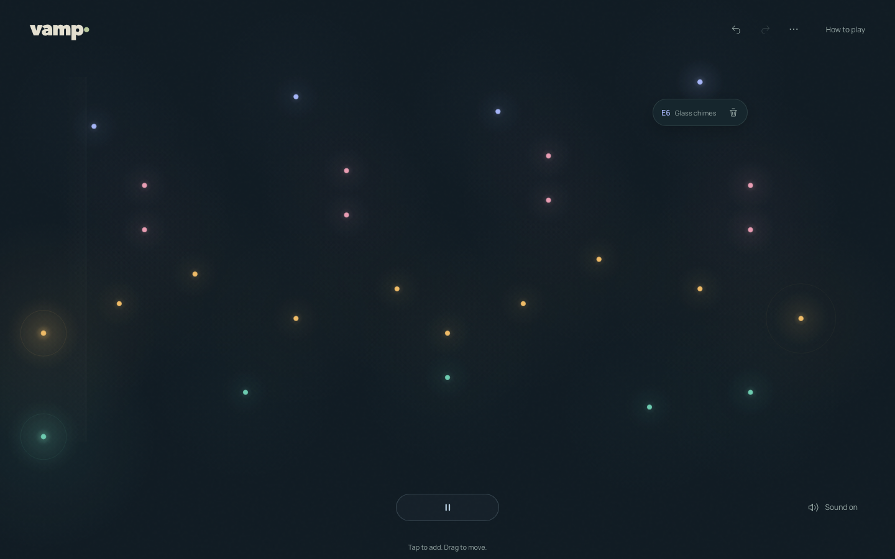

# Vamp

A musical sketchbook for composing loops with light.



[Play Vamp](https://vamp.gadkadosh.workers.dev/)

Built with React, TypeScript, Canvas 2D, and native Web Audio synthesis.

The main page is one public composition: everyone can edit it, and changes are saved and shared live.
Playback and sound controls are personal, not synchronized.

Turn on **Solo mode** (or open `/solo`) to sketch privately in this tab. Solo sketches are kept
while switching modes, but reloading starts fresh. Undo and redo are available only in Solo mode.

## Development

Use Node.js 24 LTS and pnpm.

```sh
pnpm install
pnpm types
pnpm dev
```

```sh
pnpm check      # Formatting, lint, and types
pnpm test --run
pnpm build
```
